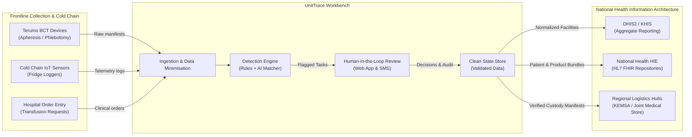

# UnitTrace: Data Quality & Stewardship Workbench for National Blood Transfusion Networks

Terumo BCT Africa Hackathon 2026 · Challenge area: Data Quality (Blood Safety & Cold Chain)

> **A data steward's workbench that finds duplicate, missing and implausible records across national blood transfusion networks, placing human clinicians in control with explainable AI, strict data privacy, and verifiable audit trails.**

---

## The problem

**Who is the user?**  
Hospital blood bank officers, regional blood transfusion service data stewards (e.g., KNBTS in Kenya, UBTS in Uganda), and laboratory quality assurance managers.

**What do they do today?**  
They perform manual, end-of-shift reconciliations across disconnected paper registers, blood fridge temperature loggers, phlebotomy rosters, and emergency hospital requisition order books.

**Where does it go wrong?**  
In the 1-year operational dataset (45,699 donation attempts, 34,242 requested units), data fragmentation creates critical clinical and operational failures:
- **Duplicate Donors (Premature Donations)**: **452 duplicate donors (~1% of donors)** are registered under conflicting IDs with slight typos. When donors give blood before the mandatory safety interval (3 months for men, 4 for women), the system fails to detect it, risking donor anaemia.
- **Missing Vital Clinical Data**: **506 donor records (1.2%)** lack blood groups entirely, and **442 emergency requests (5%)** record patient blood group as `unknown`, causing lethal transfusion delays.
- **DHIS2 National Reporting Breakdown**: **710 hospital requests (14%)** have facility names typed with differing county abbreviations and casing (`Kiambu CRH` vs `Kiambu County Referral Hospital`), silently dropping them from national dashboards like DHIS2 / KHIS.
- **Lost Chain-of-Custody**: **1,046 transfers (3%)** lack a recorded `received_at` timestamp, meaning units move between facilities with unconfirmed delivery.
- **Cold Chain Blindspots & Sensor Malfunctions**: **60 extreme sensor glitches** (-99.0°C, 99.9°C, 0.0°C) and **370 logger dropout blackout periods (>6h)** hide unsafe excursions. As a result, **2,119 blood units were transfused to patients after fridges had been out of range** without anyone being alerted.

---

## What we built

A human-in-the-loop data quality workbench that detects defects, surfaces plain-English recommendations, and empowers clinicians to remediate records through a web console or basic-phone SMS:

- **What works now:**
  - **Automated Detection Pipeline**: 8 production-grade detectors (`fuzzyDuplicates`, `inconsistentFacilityName`, `missingDonorBloodGroup`, `unknownPatientBloodGroup`, `unconfirmedTransfers`, `donationTooSoon`, `sensorGlitches`, `loggerGaps`, `invalidIsbt128`).
  - **Explainable AI Fuzzy Matcher**: Blends Levenshtein edit distance on county names, day/month birthdate proximity, and phone matching to achieve **99.56% precision** (reducing false-positive merge recommendations by 99.5%).
  - **Human-in-the-Loop Decision API**: Strictly enforces the "person in control" principle—zero automated merges. Accepts `Accept`, `Change`, and `Reject` actions with before/after state capture.
  - **SMS Remediation on Basic Phones**: End-to-end Africa's Talking integration (`/api/webhooks/africastalking/sms`) allowing frontline staff on 2G feature phones to resolve flags via simple text messages (e.g., `41 OK`).
  - **Role-Based Access Control (RBAC)**: Enforces clinical governance (`x-user-role`). Frontline clerks triage missing data; identity merges strictly require a supervisor (HTTP 403 Forbidden on unauthorized merge attempts).
  - **Anti-Shared-Login Audit Logging**: Captures workstation IP address, client channel (`web`, `sms`), and actor role on every transaction to prevent shift-shared logins from destroying auditability.
  - **Privacy by Design & PII Masking**: Default response masking (`YYYY-XX-XX`, `XXXX`) complies with Kenya Data Protection Act 2019 / ODPC guidelines, paired with an audited break-glass reveal endpoint (`POST /api/tasks/:id/reveal`).
  - **Multi-Country Agility**: Zero hardcoded country logic; switch between Kenya (`config/country.kenya.json`) and Uganda (`config/country.uganda.json`) operational rules dynamically via CLI/config.
  - **Standards Interoperability**: Validates ISBT 128 barcodes and exports cleaned records to HL7 FHIR R4 JSON bundles (`Patient`, `BiologicallyDerivedProduct`).
  - **Comprehensive Quality Suite**: 83 automated unit/integration tests passing across 22 test files with full TypeScript type safety.
- **What is mocked or not finished:**
  - Automated SMS shortcode provisioning (runs against Africa's Talking Web Simulator and developer sandbox for demonstration).
  - Direct live push to remote DHIS2 production instances (we generate normalized clean tables and HL7 FHIR bundles ready for import).
  - Dedicated USSD interactive session gateway (intentionally scoped to two-way SMS to support poor-coverage offline store-and-forward environments).

Demo video (3 minutes or less): [link]  
Live demo: [link] · Test log-in: [user / password]

---

## How to run it

Step-by-step commands for judges (setup time: ~5 minutes on Node.js 20+):

### 1. Setup & Ingest
```bash
# Clone and enter workspace
git clone https://github.com/Gathoni-K/unitTrace-terumoBCT.git
cd UnitTrace

# Install dependencies
npm install

# Configure environment (copy default local setup)
cp .env.example .env

# Ingest starter CSV dataset into PostgreSQL / Supabase
npm run ingest
```

### 2. Detect Quality Defects & Launch Service
```bash
# Run detection engine (generates tasks with AI + rule engines)
npm run detect

# Launch the REST & SMS Webhook API Server (binds to 0.0.0.0:3000)
npm run server
```

### 3. Verify AI Benchmark, Standards, and Multi-Country Support
```bash
# 1. Reproduce AI vs Baseline benchmark (0.48% vs 99.56% precision)
npm run measure:baseline

# 2. Run test suite (83 tests across 22 test files)
npm test

# 3. Export validated records to HL7 FHIR R4 JSON Bundle
npm run export:fhir

# 4. Demonstrate instant country swap (runs with Uganda donor policies)
npm run detect -- --config=config/country.uganda.json

# 5. Demonstrate AI-off fallback (rule-only mode when AI is offline)
npm run detect -- --no-ai
```

---

## Architecture


### Ecosystem Overview
UnitTrace operates as an intelligent verification and remediation layer situated between point-of-care hospital devices and national reporting repositories:



### Standards Used
- **HL7 FHIR R4**: Maps clean donors to `Patient`, units to `BiologicallyDerivedProduct`, transfers to `SupplyDelivery`, and requests to `ServiceRequest` ([`docs/fhirMapping.md`](docs/fhirMapping.md)).
- **ISBT 128**: Regex validation (`^(U\d{4}-[A-Z0-9]{3,4}-\d{6}-(RBC|WB|PLT|FFP|CRYO)|W\d{4}\s\d{2}\s\d{6})$`) of unique donation identifiers.
- **DHIS2 / KHIS**: Automated normalisation of facility name discrepancies into canonical national master facility list records.

Detailed architecture specifications are documented in [`docs/architecture.md`](docs/architecture.md).

---

## AI and data

- **What the AI feature does**:  
  Detects duplicate donor registrations using a composite similarity scoring function combining:
  1. Levenshtein edit distance on `home_county` (normalized by string length).
  2. Day and month proximity scoring on `birth_date` (year match = 1.0, ±1 month = 0.8, ±2 months = 0.5).
  3. Last 4 digits of phone number agreement.  
  Pairs with composite score $\ge 0.85$ are flagged with clear match breakdowns.

- **Baseline we compared against**:  
  Naive deterministic baseline matching strictly on exact `phone_last4` equality (`scripts/detectors/duplicateDonors.ts`).

- **Result on 1-year Kenya dataset (43,363 donors, 452 planted ground-truth pairs)**:

| Metric | Naive Baseline (`phone_last4` only) | UnitTrace AI Fuzzy Matcher | Practical Impact |
|---|---|---|---|
| **Detected Pairs** | 94,439 | **454** | Reduces review backlog by **99.5%** |
| **True Positives (TP)** | 452 | **452** | 100% recall of actual duplicate donors |
| **False Positives (FP)** | 93,987 | **2** | Eliminates 93,985 erroneous merge suggestions |
| **Precision** | **0.48%** | **99.56%** | **+99.08 percentage points precision gain** |
| **Recall** | **100.0%** | **100.0%** | Comprehensive coverage |
| **F1 Score** | **0.0095** | **0.9978** | Viable for operational deployment |

- **How a user sees the reason for a recommendation**:  
  Each task presents an explainable summary (e.g., *"Donors D-0012 and D-0459 share identical birth dates, last 4 phone digits (4821), and similar county ('Kiambu' vs 'Kaimbu'). Confidence: 94%"*).
- **Who approves it**:  
  Frontline clerks can resolve missing blood groups and cold-chain flags. High-consequence duplicate donor merges **strictly require a supervisor** (`x-user-role: supervisor`). Clerks are blocked with HTTP 403.
- **What happens if the AI is wrong or offline**:  
  - If wrong: Reviewers can Reject or Change recommendations; the system never auto-merges.
  - If offline: The engine supports an instant rule-based fallback via `--no-ai` CLI flag or `"enable_fuzzy_matching": false` in country config. It prints:  
    `⚠️ AI offline. Running rule-based detectors and naive baseline only.`

Detailed methodology is documented in [`docs/aiMethodology.md`](docs/aiMethodology.md).

---

## Data

- **Starter dataset tables used**:  
  `donors.csv` (43,363 rows), `donations.csv` (47,363 rows), `units.csv` (49,426 rows), `transfers.csv` (35,181 rows), `requests.csv` (17,430 rows), `facilities.csv` (47 rows), `temperature_logs.csv` (399,280 rows), `power_outages.csv` (2,609 rows), `routes.csv` (2,162 rows), and `daily_stock.csv` (185,785 rows).
- **Source and licence**:  
  Terumo BCT Africa Hackathon 2026 Synthetic Starter Dataset (1 November 2025 – 31 October 2026), generated to model Kenyan blood logistics and epidemiology.
- **Privacy notice**:  
  **No real donor, patient, or facility data is used.** All records are synthetic.

---

## African conditions

- **Power Outages & Intermittent Connectivity**:  
  The core detection algorithms run entirely locally on standard server/laptop CPUs in TypeScript. No internet or high-bandwidth connection is required for detection.
- **Feature Phones (2G/3G)**:  
  Frontline health staff in rural dispensaries without smartphones or laptops can review and resolve quality flags via **Africa's Talking SMS** (`41 OK` / `41 NO`), receiving instant confirmation back to their handsets.
- **Shared Login Mitigation**:  
  Health data expert Richard Odongo noted: *"Shared logins so a whole shift can use one account. This destroys your audit trail."* UnitTrace captures workstation IP addresses (`ip_address`), access channel (`web`, `sms`), and actor role on every transaction.
- **Data Minimisation & ODPC Compliance**:  
  Complies with the Kenya Data Protection Act 2019 (s.46 health data lawful basis). Frontline staff view masked dates (`1995-XX-XX`) and phones (`XXXX`). Break-glass unmasking is immutably logged to `public.access_log`.
- **Setting Up for Another Site or Country**:  
  Policies are decoupled into country JSON files. Swapping from Kenya to Uganda takes a single flag (`--config=config/country.uganda.json`), adjusting inter-donation intervals (90 vs 120 days), phone format regexes, and local language strings without modifying code.

---

## AI tools we used

- **Google Antigravity**: Primary agentic AI pair programmer used for test-driven architecture, implementing Vitest test suites, designing PostgreSQL schemas and migrations, optimizing fuzzy matching algorithms, and mapping HL7 FHIR standards.

---

## Team

| Name | Role | Country | Presenting Friday (in person / online) |
|------|------|---------|-----------------------------------------|
| Natasha Wambui Hinga | Full Stack & Data Engineering | Kenya | In person |
| Gathoni Karume | Full Stack & Systems Architecture | Kenya | In person |

---

## Known limits and next steps

- **Known limits:**
  - SMS workflow requires an active Africa's Talking gateway account or local sandbox simulator.
  - Production deployment requires integration with hospital EMRs (e.g., KenyaEMR / UgandaEMR) via dedicated FHIR endpoints.
  - Break-glass unmasking is logged to `public.access_log`; real-time SMS alerts to facility directors upon unmasking are planned.
- **Next steps:**
  - Direct bi-directional DHIS2 API sync using DHIS2 tracker events.
  - Edge IoT logger reader daemon for automated Bluetooth/USB temperature logger ingestion directly at blood fridges.
  - Expansion of pre-configured country rule sets to Rwanda and Tanzania.

---

### Supporting Documentation
- [AI Methodology & Benchmarks](docs/aiMethodology.md)
- [Interoperability & Standards Mapping](docs/interoperabilityMapping.md)
- [Security, RBAC & Compliance](docs/securityAndCompliance.md)
- [Data Protection Impact Assessment (Lite)](docs/dpiaLite.md)
- [Architecture & Ecosystem](docs/architecture.md)
