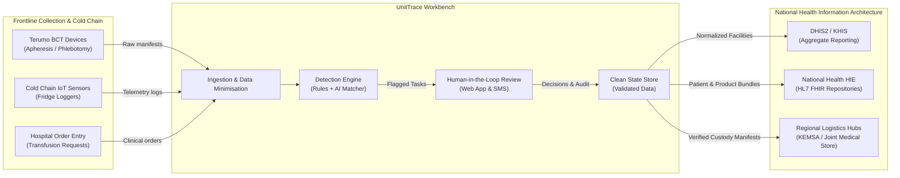
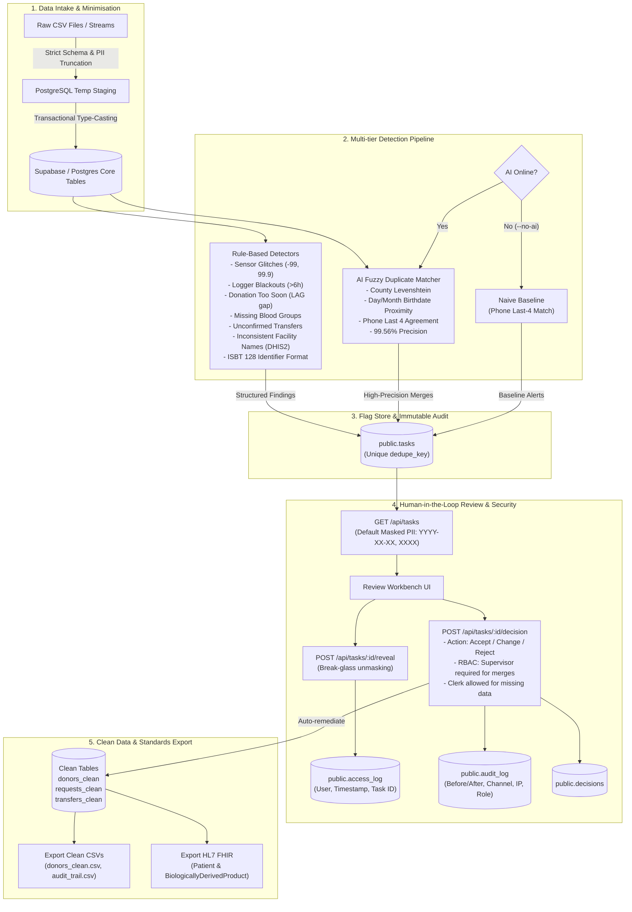

# UnitTrace Architecture & Ecosystem Specification

UnitTrace (Data Quality Workbench) is an intelligent, privacy-preserving data quality inspection and human-in-the-loop remediation engine designed for national blood transfusion services.

---

## 1. High-Level Ecosystem Placement

The workbench sits as a resilient verification and remediation buffer between frontline medical devices/regional blood collection hubs and national health aggregation systems (such as DHIS2, Kenya Health Information System / KHIS, and Uganda eHMIS).

---

## 2. End-to-End Processing & Governance Pipeline

---

## 3. Layer Specifications

### 3.1 Country Configuration Layer (`config/country.<country>.json`)
- **Zero hardcoded rules**: Thresholds, temperature boundaries, minimum inter-donation days, phone regexes, and local translations live in external JSON files validated by Zod schema (`CountryConfig`).
- **Dynamic Country Swap**: CLI and services accept `--config=<path>` to run seamless multi-tenant deployments (e.g., Kenya vs Uganda blood bank rules).

### 3.2 Human-in-the-Loop & Person-in-Control Principle
- **No auto-merging**: Algorithmic predictions generate review tasks with explainable English rationales and proposed fixes.
- **Role Enforcement (RBAC)**: Clerks resolve missing operational data; high-consequence donor merges strictly require supervisor authorization (`x-user-role: supervisor`), returning HTTP 403 otherwise.
- **Anti-Shared-Login Audit**: Captures workstation IP address, client channel (`web`, `sms`), and actor role on every transaction.

### 3.3 Data Minimisation & Privacy by Design (ODPC & DPIA)
- Personal data is masked by default on all endpoints (`birth_date` → `YYYY-XX-XX`, `phone_last4` → `XXXX`).
- Non-essential fields (`preferred_channel`, `consent_to_contact`, raw national ID numbers) are omitted from persistent schemas.
- Unmasking events are logged as immutable security events in `public.access_log`.
